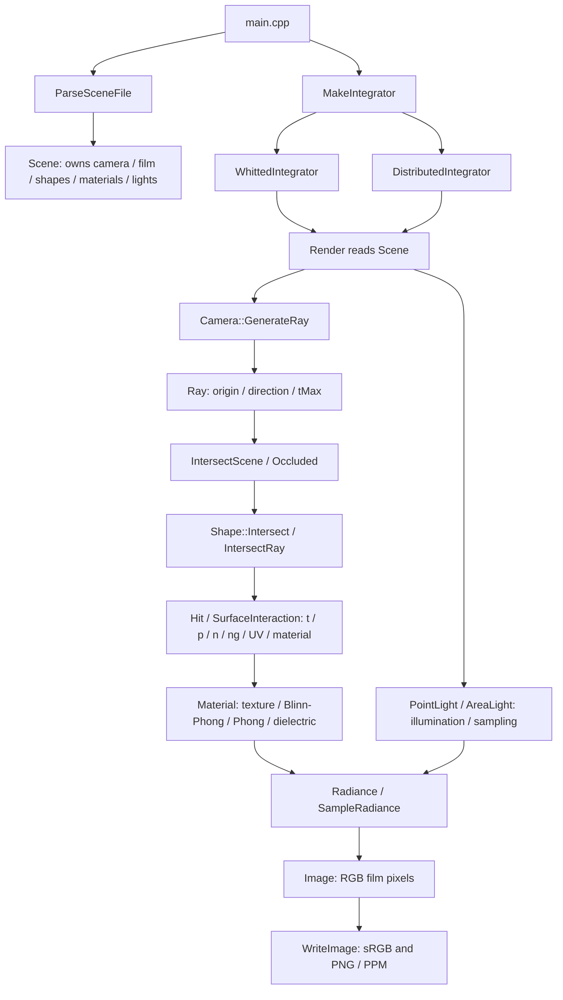

# Module 1 技术证据补充

本文件记录代码职责、参数作用和可复现检查，不是报告段落、图注或本人调试经历。
参数的实际作用不等于历史选择理由；学生应按真实经历自行解释。

## 1. 类结构和数据流

| 类型/函数 | 所有权或职责 | 源码定位 |
|---|---|---|
| `Scene` | 持有 `Camera`、`Film`、shape/light/material 容器与积分参数；shape 引用 Scene 所有的 material | `source/scene/scene.h:24` |
| `Camera` | 将像素/透镜样本映射到世界射线；不知道材质或光照 | `source/scene/camera.cpp::GenerateRay` |
| `Shape` | 求交、几何/着色法线与 UV；不计算辐射亮度 | `source/scene/shape.h` |
| `SurfaceInteraction` / `Hit` | 几何命中到着色计算之间的记录 | `source/scene/shape.h:18`、`source/integrator/integrator.h:15` |
| `Material` | 材质参数、纹理查询、BRDF 与 delta 类型判断 | `source/scene/material.h/.cpp` |
| `Light` | 点光源强度；面光源位置采样、面积、PDF、发射亮度 | `source/scene/light.h/.cpp` |
| `Integrator` | 公共 `Render(const Scene&) -> Image` 接口；运行时由名称选择实现 | `source/integrator/integrator.h:26` |
| `WhittedIntegrator` | 中心主射线、点灯直接光、镜面/玻璃递归 | `source/integrator/whitted.cpp` |
| `DistributedIntegrator` | 独立 lens/light 样本、BRDF 直接光、delta 递归、HDR 平均与 Reinhard | `source/integrator/distributed.cpp` |
| `Image` / `WriteImage` | RGB 存储及输出编码；不负责求交/光照 | `source/core/image.h/.cpp` |

实际依赖不是严格的 `Shape -> Material -> Light` 单向链：integrator 读取命中材质并访问灯，
通过 shadow query 测试遮挡，再组合 BRDF、可见性、灯量及路径权重。WSRT/DRT 共享 scene、
几何、纹理和相机，积分与采样策略分开。当前 `IntersectScene` 线性遍历，没有 BVH。

## 2. 参数：已知作用与未确认的选择理由

| 设置 | 当前事实/代码后果 | 不能从数值推断的内容 |
|---|---|---|
| WSRT MD=8/10 | `depth >= MD` 返回 0；creative 有镜面架/托盘和玻璃瓶，可出现多次 delta 命中；增深允许更长路径也可能增加工作量 | 未做 MD sweep；无法证明 8/10 最优、收敛或是学生亲自比较后选择 |
| 旧基线 DRT spp=32/24（当前主图128/96） | 每像素固定中心；重复 lens/light 采样；每次相机样本每灯默认1点；creative 1230 primitives、simple 336 | 用户已提供提采样后的观察；未记录噪声误差指标，不能量化噪声降低比例，也不能推断旧数值的历史选择理由 |
| 面灯 simple=25.2/5.75、creative=29.4/9 | 矩形世界面积；局部可见性随采样位置变化，形成半影；面积还进入 PDF | 面积不是单独决定软硬的参数；距离/形状/遮挡物同样影响，不能声称复制了真实室内灯尺寸 |
| simple A=0.18、D=9 | A 是半径；D 是沿 forward 的平面距离，不是射线固定长度；前方红球与后方盒偏离焦面 | 不能把所有纹理颗粒归为离焦；需要 A=0 同样本/分辨率对照 |
| creative A=0.14、D=10 | 透镜样本仍聚焦到同一平面点；键盘、瓶子和椅背位于不同 forward 深度 | 未做光圈 sweep；不证明所有主要物件都恰好在焦平面上 |
| W=8 | 每 RGB 通道 extended Reinhard，先 HDR 平均再映射/clip，最后 sRGB | 不能从白屏外观证明没有裁剪；当前未保存原始 HDR 受控对照 |

学生需核实：目标物体/区域是什么、为何接受当前成本和噪声、实际比较过哪些候选值。
可讨论算法上的取舍，但不要将其改写为未发生过的参数实验或个人决定。

## 3. 数值检查的直接定位

运行 `python3 scripts/collectModule1Evidence.py`，生成
`output/module1-evidence/module1_checks.log` 和 `manifest.json`。
原有 50 个检查保持不变，补充 `EVIDENCE` 行记录实际数值；日志里的 PASS 标签可直接搜索。

| 证据 ID / PASS 标签 | 输入与预期 | 实现/测试定位 |
|---|---|---|
| `mirror.tangent_x`、`mirror.normal_y` | 入射 normalize(1,-1,0)，n=(0,1,0)；x 保持、y 反号 | `tests/module1_checks.cpp` 搜索 `mirror preserves tangent`；`source/core/vec.h::Reflect` |
| `snell.air_glass_30.sin_theta_t` | air→glass 30°，eta=1/1.5；预期 1/3 | 搜索 `Snell: air to glass`；`source/core/vec.h::RefractIncident` |
| `fresnel.normal_incidence.R` | eta=1.5、cos=1；预期0.04 | `source/scene/material.cpp::FrDielectric` |
| `fresnel.glass_air_60.R` | etaT/etaI=1/1.5、cos=0.5；预期1；另有透射函数返回 false 的 PASS | 搜索 `60 degrees` / `Fresnel TIR` |
| `camera.planar_focus.point_distance` | 非中心像素 (0.9,0.7)、D=10、两个镜头样本；焦面交点距离预期0 | 搜索 `different lens origins`；`source/scene/camera.cpp:175` |
| `phong.hemisphere` | diffuse=1、ks=0.8、e=20；256×256积分；0°/45°/80°各记录实际能量，上界1.0001 | 搜索 `Independently integrate`；`source/scene/material.cpp::Material::F` |
| `rectangle.fixture.area`、`rectangle.fixture.solid_angle_pdf` | 面积4、r²=4、cos=1；PDF预期1 | 搜索 `rectangle samples actual corners`；`tests/fixtures/module1.pbrt` |
| `reinhard.c4_W4`、`reinhard.c0_5_W1` | 4/W4→1，0.5/W1→0.5 | `source/core/image.cpp::ToneMapReinhard`；测试搜索 `Reinhard` |

实际值从本次日志读取，而不是根据预期手工填写。测试通过只验证这些输入和容差。

本次实测摘录（50 checks、0 failures，完整记录在上述日志）：

| ID | 实际值 | 预期/上界 |
|---|---:|---:|
| Snell 30° sin(theta_t) | 0.333333333333 | 1/3；误差5.55e-17 |
| 正入射 Fresnel R | 0.04 | 0.04；误差6.94e-18 |
| glass→air 60° Fresnel R | 1 | 1 |
| 两个 lens samples 的焦面点距离 | 0 | 0 |
| Phong 0° 半球积分 | 0.999765054384 | ≤1.0001 |
| Phong 45° 半球积分 | 0.765690070758 | ≤1.0001 |
| Phong 80° 半球积分 | 0.360274220793 | ≤1.0001 |
| fixture 面灯面积 / PDF | 4 / 1 | 4 / 1 |
| Reinhard c4/W4、c0.5/W1 | 1、0.5 | 1、0.5 |

## 4. 诊断方法：可复现核查，不是过去的本人经历

| 问题 | 当前可执行的定位步骤 | 可核实证据 | 尚缺历史材料 |
|---|---|---|---|
| 反射符号 | 在 n=(0,1,0) 的平面上检查已知入射方向；比较 helper 输入是否为 -ray.d；再测试深度终止 | 切向/法向分量 PASS、镜面背景路径 PASS、终止0 PASS | 首次错误图、谁发现、原错误输出 |
| 介质出口 | 从玻璃球中心向外发射 ray；核对未翻转 ng 与 ray.d 的点积；独立测试 Snell/Fresnel/TIR | `inside glass ray selects exit medium`，出口权重含0.96×1.5² | 当时出口异常、实际排查次序与本人贡献 |
| 面灯坐标系 | 固定样本 (0,0)，检查实际矩形角点、世界法线；再独立核对面积和 PDF | fixture 角点(-1,-1,-2)、面积4、PDF1；disc transform PASS | 哪张原图/哪个数值触发怀疑，不凭当前 PASS 倒推 |
| 焦面 | 固定非中心像素，两 lens origins；分别求与 forward 深度10平面的交点并比较 | `camera.planar_focus.point_distance` | 原球面聚焦错误的截图/测试输出及诊断者 |

这些检查由 agent 本次运行；不可写成学生曾独立执行并定位同样错误。
如果没有旧失败日志，可以如实记录修复后检查，勿编造“某次测试先失败”的故事。

## 5. 景深与串行基线

`python3 scripts/collectModule1Evidence.py --render` 会先执行原有数学检查，再串行渲染四个原场景、
两个 aperture=0 的 DRT 变体。变体位于 `scenes/DRT_simple_pinhole.pbrt` 与
`scenes/DRT_creative_pinhole.pbrt`，只改变 `apertureradius`；材质、灯、分辨率、spp、MD、W、
相机位置/FOV/focus 与原场景相同。资产路径保持相对于 `scenes/`。

输出都在 `output/module1-evidence/`；manifest 保存命令、输入/二进制 SHA256、环境、时间及 parse 状态。
新 `baseline.csv` 的四条主图记录来自同一脚本串行执行；这不等于彻底消除 OS 背景负载。
两个对照使用固定 sample index 的同一 light sampling 方式，lensRadius=0 绕过镜头偏移。
不改变 area light，所以针孔图仍有软阴影和 light sampling 噪声。

日志细节：`parser.cpp` 在 A=0 时走 `ConfigurePerspective`，日志中的 camera focus 因而显示
默认1，而 scene文件的 focusdistance仍为9/10。针孔分支完全不使用焦距，因此这不会改变针孔图；
对照面板写 `D_scene` 指输入文件值，不把日志中的默认1误当成改了场景焦距。

可选 `--compare` 生成原分辨率并排图及 nearest-neighbour 局部放大：

- `DRT_simple_dof_comparison.png`：前方红球、后方棋盘盒。
- `DRT_creative_dof_comparison.png`：左侧椅背、键盘。

原场景 A>0 与变体 A=0 是受控景深证据；低 spp 下噪声仍在，不能由一次差分估计统计收敛性。

本次已完成六次渲染，全部 parse warnings/errors=0/0。两张并排图的可观察位置：

| 对照区域 | A>0 图 | A=0 图 |
|---|---|---|
| simple 前方红球轮廓 | 轮廓向背景扩散，边界较宽 | 球体轮廓明确，仍有像素阶梯和光采样噪声 |
| simple 后方盒左边缘/棋盘线 | 外边缘与色块边界较宽 | 边缘与色块分界更清晰 |
| creative 左椅背外轮廓 | 轮廓略有扩散 | 轮廓更锐利、像素阶梯更明显 |
| creative 键盘 | 有少量线条/边缘展宽 | 线条较锐利；两者都受低分辨率和噪声影响 |

当前主图不需要因为相机错误而替换：代码的焦面汇聚检查通过，A=0 对照也有可见差异。
如果使用对照，学生自行解释原图与对照图。creative 小区域的差异弱于 simple，不能声称
现有24 spp/480×320已经充分解决噪声；是否增加主图采样数由学生按画质/成本决定。

本次统一串行主场景计时（Apple M2 Pro，C++17、-O3，renderer单线程）：

| Scene | Resolution | spp | MD | primitives | Render seconds |
|---|---|---:|---:|---:|---:|
| WSRT_simple | 900×560 | 1 | 8 | 8 | 0.160064 |
| WSRT_creative | 960×640 | 1 | 10 | 1230 | 19.534114 |
| DRT_simple | 600×400 | 32 | 4 | 336 | 64.005217 |
| DRT_creative | 480×320 | 24 | 5 | 1230 | 108.098545 |

针孔变体时间为60.952448 s、107.015365 s，仅记录此次运行，不作为景深成本的统计估计。
所有运行都逐个启动，没有同时运行另一个 renderer；系统后台负载未控制。完整元数据在
`output/module1-evidence/manifest.json`。旧主目录日志保留原计时，新旧时间不可混用为同一轮实验。

## 6. 报告历史、身份与导出

- 照片拍摄者/地点：用户已确认学生本人、学校 Teviot 楼；日期未提供。
- 上一轮 agent 实际写过报告正文/图注；保留真实使用记录，并向老师确认处理方式。
- 过去代码 prompt、本人观察和验证经历由学生提供，不根据本次技术核查虚构。
- 用户已确认 exam number 为 `B252751`；标题页已同步。
- `make module1-report` 只编译现有 TeX 并导出到 `reports/Module1.pdf`；正确路径不表示内容已获提交许可。
- 未做 PBRT-v4 系统差分不单独构成 Module 1 漏交；该系统测试要求位于 Module 3。

## 7. 后续高采样主图更新

当前 `output/DRT_simple.png` / `DRT_creative.png` 已由用户重渲染为128/96 spp，分辨率仍为
600×400 / 480×320；日志 render time=252.429880 / 437.498226 s，simple film max=0.970703。
两张标注图参数栏已同步，用户确认两次运行是串行的。TeX 的对应数据已同步。

第5节和 `output/module1-evidence/` 保留此前32/24 spp的完整基线和针孔对照。
它们仍是旧低采样图之间的受控比较，不能把旧A=0图和当前128/96 spp主图当成只改变光圈的对照。
scene原文件已改采样数，旧manifest中的source hash不再与当前主scene匹配，这是版本差异，非新渲染失败。
用户提供的画质观察原文保存在 `module1-student-inputs.md` 第5节。
